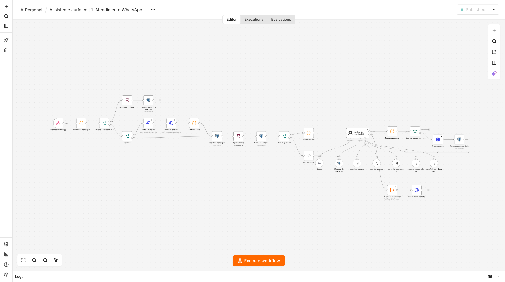
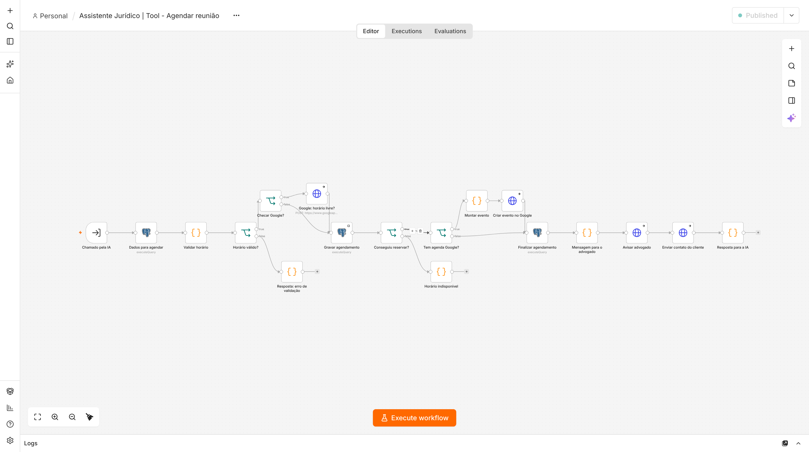
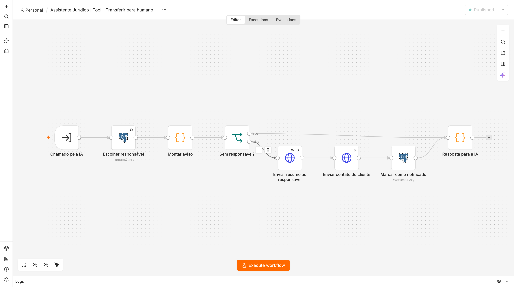
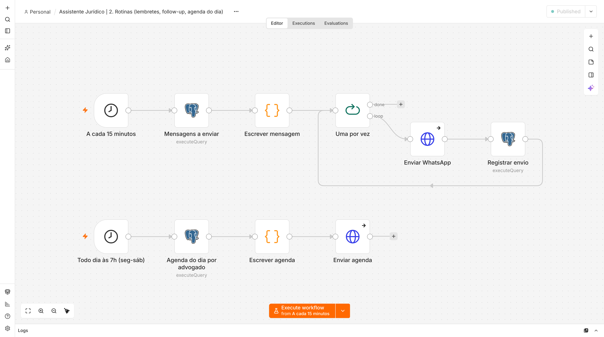

# Assistente Jurídico 24h (n8n + WhatsApp + IA)

Atendimento automático por WhatsApp para escritórios de advocacia. A assistente:

- **conversa de forma natural**, tira dúvidas e faz a triagem do caso (nome, área, resumo, urgência);
- **agenda, confirma, remarca e cancela reuniões** com o advogado certo, sem conflito de horário, com Google Agenda e link do Meet;
- **encaminha para o advogado ou pessoa responsável** quando precisa: envia o resumo e o **cartão de contato do cliente** para o WhatsApp dela e pausa a IA na conversa;
- manda **lembretes** 24h e 1h antes, faz **follow-up** de quem parou de responder e envia a **agenda do dia** para cada advogado às 7h;
- segue regras da **OAB e LGPD** (não dá parecer jurídico, se identifica como assistente virtual, pede consentimento).

Um único servidor atende **vários escritórios** (multi-tenant): cada escritório é um número de WhatsApp.

---

## Como funciona

```
Cliente no WhatsApp
   │
   ▼
Evolution API ──webhook──▶ n8n: "1. Atendimento WhatsApp"
                              │ 1. normaliza a mensagem (texto, áudio → transcrição, imagem, documento)
                              │ 2. grava no banco e espera 8s (junta mensagens em sequência)
                              │ 3. IA pausada? (humano atendendo) → não responde
                              │ 4. monta o contexto: escritório, equipe, FAQ, dados e reuniões do cliente
                              │ 5. Agente de IA (Claude) + memória da conversa + ferramentas:
                              │      • consultar_horarios      • agendar_reuniao
                              │      • gerenciar_agendamento   • registrar_dados_cliente
                              │      • transferir_para_humano
                              │ 6. responde em até 3 mensagens, com "digitando…"
                              ▼
                        Postgres (banco "agente") ◀──▶ Google Agenda (opcional)
                              │
   Advogado responsável ◀─────┘ (resumo + contato do cliente pelo WhatsApp do escritório)
```

### Como ficam os fluxos no n8n

**Fluxo principal: atendimento pelo WhatsApp**


**Agendar reunião** (valida o horário, reserva sem conflito, cria o evento no Google e avisa o advogado)


**Transferir para humano** (escolhe o responsável e envia resumo + contato no WhatsApp dele)


**Rotinas** (lembretes, follow-up e agenda do dia)


### Fluxos (pasta `fluxos/`)

| Fluxo | O que faz |
|---|---|
| **1. Atendimento WhatsApp** | Fluxo principal: recebe as mensagens, agente de IA, responde. Se a IA falhar, avisa o cliente e encaminha para a equipe. Detecta quando alguém da equipe responde pelo celular e pausa a IA. |
| **2. Rotinas** | A cada 15 min: lembretes de reunião (24h e 1h antes) e follow-up de quem parou de responder. Todo dia às 7h (seg a sáb): agenda do dia para cada advogado. |
| **3. Retomar IA (Chatwoot)** | Quando a equipe marca a conversa como resolvida no Chatwoot, a IA volta a atender o cliente. |
| **0. Alerta de erros** | Se qualquer fluxo der erro, avisa o administrador no WhatsApp. |
| Tool - Consultar horários | Calcula os horários livres do advogado da área (expediente, intervalo, antecedência mínima, reuniões já marcadas e Google Agenda). |
| Tool - Agendar reunião | Valida o horário, reserva sem risco de conflito, cria o evento no Google Agenda (com Meet se for online) e avisa o advogado com o contato do cliente. |
| Tool - Gerenciar agendamento | Lista, confirma, cancela ou remarca, sempre só as reuniões do próprio cliente. |
| Tool - Registrar dados | Salva nome, e-mail, área, resumo, urgência e consentimento LGPD. |
| Tool - Transferir para humano | Escolhe o responsável, envia resumo e contato no WhatsApp dele, pausa a IA e registra o encaminhamento. |

### Quem recebe o atendimento

A função `escolher_responsavel` (no banco) decide nesta ordem:

1. o advogado que **já acompanha** o cliente, se ele atende a área pedida;
2. em caso **urgente**, quem está marcado para receber urgências;
3. quem **atende a área** do caso, distribuindo pela menor carga dos últimos 30 dias;
4. o responsável **padrão** do escritório;
5. qualquer pessoa ativa.

Duas reuniões nunca se sobrepõem para o mesmo advogado: uma *constraint* no banco bloqueia isso, mesmo se dois clientes escolherem o mesmo horário ao mesmo tempo.

### Quando a IA para de responder

- Depois de **transferir para humano**: fica pausada por `horas_pausa_ia` (12h por padrão).
- Quando **alguém da equipe responde** pelo WhatsApp do escritório (celular, WhatsApp Web ou Chatwoot).
- Para **reativar antes**: envie `#ia` na conversa ou resolva a conversa no Chatwoot.

---

## Instalação

### O que você precisa

1. **VPS Ubuntu 22.04/24.04**, com no mínimo **4 GB de RAM** e 2 vCPU (Hetzner, Contabo, Hostinger etc.).
2. **Domínio** com 3 registros DNS tipo **A** apontando para o IP do VPS: `n8n`, `api` e `chat`.
3. **Chave da Anthropic** (Claude): <https://console.anthropic.com>.
4. Opcional: **chave da OpenAI**, para transcrever áudios.
5. Opcional: **Google Cloud OAuth**, para o Google Agenda (veja abaixo).
6. **Chip de WhatsApp** dedicado para cada escritório.

### Passo a passo

```bash
git clone https://github.com/joaomarcoss1/n8n.git assistente-juridico
cd assistente-juridico
cp .env.example .env
nano .env        # preencha ANTHROPIC_API_KEY, ADMIN_WHATSAPP e, se quiser, OPENAI e GOOGLE
sudo ./install.sh seudominio.com.br voce@seudominio.com.br
```

O `install.sh` instala o Docker, configura o firewall, gera as senhas que faltam no `.env`, sobe os serviços (n8n, Evolution API, Chatwoot, Postgres, Redis e Caddy com HTTPS) e **importa e ativa todos os fluxos**, já com as credenciais configuradas.

> Se você rodar o `install.sh` sem criar o `.env` antes, ele cria um com senhas aleatórias. Depois, coloque a chave da IA no `.env` e rode `./scripts/importar-fluxos.sh --credenciais`.

### Cadastrar um escritório

```bash
./scripts/novo-escritorio.sh silva-advogados "Silva Advogados Associados"
```

Esse comando cria a instância do WhatsApp na Evolution API, já ligada ao n8n (com áudio em base64 para a transcrição), e cadastra o escritório no banco. Depois:

1. **Leia o QR Code**: `https://api.SEUDOMINIO/manager` → entre com a `EVOLUTION_API_KEY` do `.env` → instância → QR Code.
2. **Complete o cadastro**: endereço, áreas, horário de atendimento, advogados, FAQ. Edite e rode o modelo:
   ```bash
   nano postgres/modelo-cadastro-escritorio.sql
   docker compose exec -T postgres psql -U assistente -d agente < postgres/modelo-cadastro-escritorio.sql
   ```

Pronto: mande uma mensagem para o número do escritório e a assistente responde.

### Google Agenda (opcional)

Sem Google Agenda, a agenda fica só no banco e funciona normalmente. Com ele, a assistente respeita os compromissos que os advogados já têm, cria os eventos e gera o link do Meet nas reuniões online.

1. No [Google Cloud Console](https://console.cloud.google.com): crie um projeto, ative a **Google Calendar API** e crie uma credencial **OAuth (Aplicativo da Web)** com a URI de redirecionamento `https://n8n.SEUDOMINIO/rest/oauth2-credential/callback`.
2. Coloque `GOOGLE_CLIENT_ID` e `GOOGLE_CLIENT_SECRET` no `.env` e rode `./scripts/importar-fluxos.sh --credenciais`.
3. No n8n, abra **Credentials → Google Agenda → Connect** e autorize com a conta que tem acesso às agendas.
4. Informe a agenda no cadastro: `google_calendar_id` do escritório (agenda geral) ou de cada advogado (ex.: `ana@escritorio.com.br`).

### Chatwoot (painel da equipe)

1. Acesse `https://chat.SEUDOMINIO`, crie a conta e uma caixa de entrada do tipo **API** para o escritório.
2. Na Evolution (`/manager` → instância → *Integrations → Chatwoot*), ligue a integração com a URL `http://chatwoot-rails:3000`, o token do seu perfil e o ID da conta. As conversas passam a aparecer no Chatwoot.
3. Para a IA voltar quando a conversa for resolvida: em *Configurações → Integrações → Webhooks* do Chatwoot, adicione `http://n8n:5678/webhook/chatwoot` com o evento **Conversation Status Changed** e preencha `chatwoot_inbox_id` no cadastro do escritório.

---

## Personalizar

| O que | Onde |
|---|---|
| Dados do escritório, horários, duração da reunião, tom de voz, valores | tabela `escritorios` |
| Advogados, áreas, quem recebe urgências, agenda de cada um | tabela `responsaveis` |
| Perguntas frequentes | tabela `faq` |
| Texto do prompt da IA (regras, estilo) | fluxo **1. Atendimento WhatsApp**, nó **Montar prompt** |
| Modelo de IA (padrão: `claude-haiku-5-5`, rápido e barato; `claude-sonnet-5` responde melhor e custa mais) | nó **Claude** |
| Textos de lembrete e follow-up | fluxo **2. Rotinas**, nó **Escrever mensagem** |
| Tempo de espera para juntar mensagens (8s) | nó **Aguardar mais mensagens** |

Para atualizar os fluxos depois de mudar os arquivos em `fluxos/`, rode `./scripts/importar-fluxos.sh`. O script **sobrescreve** os fluxos com o mesmo ID. Se você editou pelo editor do n8n, exporte antes ou mantenha suas mudanças só no n8n.

## Custos (estimativa por escritório)

| Item | Custo |
|---|---|
| VPS 4 GB (atende vários escritórios) | R$ 40–100/mês, dividido entre os clientes |
| IA (Claude Haiku, com cache do prompt) | centavos por conversa |
| Transcrição de áudio (opcional) | centavos por minuto de áudio |
| WhatsApp via Evolution (não oficial) | grátis |

## Comandos úteis

```bash
docker compose ps                                   # status
docker compose logs -f n8n                          # logs
./scripts/importar-fluxos.sh                        # reimportar/atualizar fluxos
docker compose exec postgres psql -U assistente -d agente     # banco do agente
docker compose exec -T postgres pg_dumpall -U assistente | gzip > backup-$(date +%F).sql.gz  # backup
```

Consultas úteis no banco `agente`:

```sql
-- leads do dia
SELECT nome, whatsapp, area, status, criado_em FROM leads WHERE criado_em::date = current_date;
-- próximas reuniões
SELECT a.inicio, l.nome, r.nome AS advogado, a.modalidade, a.status
FROM agendamentos a JOIN leads l ON l.id = a.lead_id LEFT JOIN responsaveis r ON r.id = a.responsavel_id
WHERE a.inicio > now() AND a.status IN ('marcado','confirmado') ORDER BY a.inicio;
-- encaminhamentos em aberto
SELECT e.criado_em, l.nome, r.nome AS responsavel, e.urgencia, e.motivo
FROM encaminhamentos e JOIN leads l ON l.id = e.lead_id LEFT JOIN responsaveis r ON r.id = e.responsavel_id
WHERE e.resolvido_em IS NULL ORDER BY e.criado_em DESC;
```

## Segurança e boas práticas

- **Fixe versões** em produção: troque `latest` no `.env` pelas versões que você testou.
- **Backup diário** do Postgres e cópia do `.env` fora do servidor. Sem o `N8N_ENCRYPTION_KEY`, as credenciais do n8n não podem ser recuperadas.
- **WhatsApp não oficial**: a Evolution conecta pelo WhatsApp Web. Não envie mensagens em massa, porque o número pode ser bloqueado. Para clientes maiores, a Evolution também suporta a **Cloud API oficial da Meta**.
- **OAB/LGPD**: revise o prompt (nó *Montar prompt*) com cada escritório antes de ativar.
- A IA só altera reuniões e dados **do próprio cliente da conversa**: os IDs do escritório e do cliente são passados pelo fluxo, nunca pela IA.
